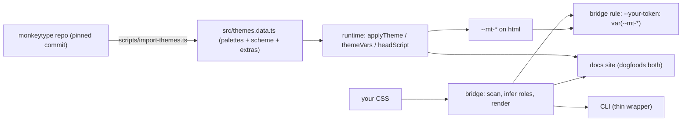

# monkeystyle: design

## Goal

Make it easy for any website to use Monkeytype's themes, without rewriting its CSS, adopting a framework, or relying on an LLM.

## Architecture



One package (`monkeystyle`) with subpath exports, zero runtime dependencies:

| Module | Purpose |
| --- | --- |
| `src/themes.data.ts` | Generated snapshot. Never hand-edited. |
| `src/color.ts` | Parsing, OKLCH, WCAG contrast, gamut mapping |
| `src/derive.ts` | 8-color categorical accent ramp per theme |
| `src/index.ts` | Runtime: list/apply/clear/persist, static CSS output, head script |
| `src/bridge.ts` | The translation layer |
| `src/cli.ts` | CLI over the above |
| `site/` | Docs site; uses the bridge CLI on its own tokens |

## Theme data

- `scripts/import-themes.ts` fetches `frontend/src/ts/constants/themes.ts` at a given commit and parses the `themes` object literal.
- **Only color values are stored.** 52 themes also ship a custom stylesheet upstream. Those target Monkeytype's own DOM (`[data-nav-item]`, `#words`…), so copying them would do nothing on other sites. Instead, the importer harvests their distinctive saturated colors into `extras` (for example, Dracula's pink, cyan, green and orange), and the accent ramp prefers those.
- `scheme` (light/dark) is precomputed from WCAG contrast of `bg` against white vs. black.

## Runtime contract

A theme is a fixed set of custom properties on the root element:

```
--mt-bg --mt-main --mt-caret --mt-sub --mt-sub-alt --mt-text
--mt-error --mt-error-extra --mt-colorful-error --mt-colorful-error-extra
--mt-accent-1 … --mt-accent-8   --mt-on-main   --mt-scheme
```

`--mt-on-main` is whichever of `bg`/`text` reads better on `main` (e.g. Serika's light bg on yellow fails, so it uses `text`).

`applyTheme` also sets `data-mt="<name>"` and `color-scheme`. It saves the **resolved variables** (not just the theme name) to localStorage, which is why the head script needs no theme data and stays ~300 bytes.

## Translation layer (bridge)

1. **Scan**: a small CSS tokenizer collects custom properties (preferring `:root`/`html` values), records which properties consume each one (`background`, `color`, `border-*`…), and lists hardcoded color literals that won't follow a theme.
2. **Infer**: each color property is scored against 15 roles:
   - **Name tokens** pick a family (`bg`/`surface`, `text`/`fg`, `border`/`line`, `accent`/`primary`…). Modifiers (`muted`, `subtle`, `strong`, `faint`, `alt`) pick a tier within it.
   - **Lightness tier**: where the color sits between the page background (0) and primary text (1), using OKLCH lightness. This tells `--fg-muted` apart from `--fg-faint`, or `--surface` from `--border`, even when names are vague. Surfaces and borders use the absolute distance from the background, because sunken surfaces can be darker than it.
   - **Chroma and hue**: saturated colors lean toward accent or danger.
   - **Usage**: being used in `background`, `color` or `border` nudges toward that family.
   - **Series**: three or more `--x-1..n` siblings become `categorical`, mapped to `--mt-accent-n`.
   - **Confidence** is a logistic of the gap between the top two scores. Each mapping carries the top reasons.
3. **Render**: one rule, default selector `html:root[data-mt]` (specificity 0,2,1, which beats common `:root[data-theme=dark]` rules without `!important`). Derived roles use native `color-mix(in oklch, …)`, so the bridge never changes between themes.

Overrides (`role` or a raw `expression`) and `ignore` let users pin anything.

## Out of scope for v1

- Sites with hardcoded colors instead of variables. The bridge reports them; a codemod to extract them into variables is v2.
- Framework wrappers (`@monkeystyle/react` etc.). The vanilla API plus the `monkeystyle:change` event already works in Astro, React, Svelte and Vue.
- Shipping a prebuilt picker UI in the core.

## Roadmap

1. ✅ v0.1: snapshot importer, runtime, bridge, CLI, docs site.
2. **Import pipeline**: scheduled GitHub Action runs the importer, diffs added/removed themes, and opens a PR.
3. **rudyorre.com**: command-menu easter egg using the generated bridge and `applyTheme`.
4. **Exporters**: Tailwind v4 `@theme`, shadcn tokens, DTCG design-token JSON.
5. **Playground upgrades**: preview a URL's stylesheet, export `monkeystyle.config.json`.
6. **Optional `<monkey-theme-picker>` web component** as a separate entry point.
